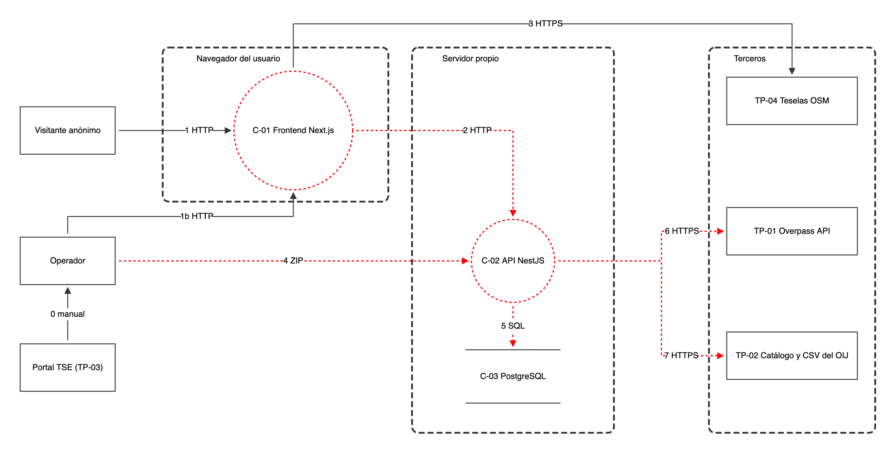

# Modelo de amenazas en OWASP Threat Dragon (ítem 1.3)

El modelo de Threat Dragon es el mapa de arquitectura y el modelo de amenazas del proyecto. Se reutiliza como el mapa del ítem 1.2 para no duplicar trabajo. El contenido textual equivalente está en [arquitectura.md](../kb/arquitectura.md) y [amenazas.md](../kb/amenazas.md), que son la fuente de verdad del texto.

**Estado:** creado y actualizado el 2026-11-11. [observatorio.json](observatorio.json) tiene 21 elementos (3 límites de confianza, 9 actores y procesos, 9 flujos) y 15 entradas de amenaza que cubren las 14 amenazas `T-01` a `T-14`. `T-07` aparece en dos flujos (OIJ y Overpass). T-14 es una propuesta pendiente de validación humana.

**Verificación (2026-11-10):** el archivo se importó en Threat Dragon web v2.6.2, en sesión local, sin errores. Se comprobó que se dibujan los 21 elementos y que los 13 IDs están presentes.

**Corrección del diseño (2026-11-11):** el primer trazado tenía flujos curvos que se cruzaban, el flujo 3 daba la vuelta por encima del servidor, y varios textos se salían de sus figuras. Se reacomodaron las posiciones: líneas ortogonales sin cruces, el flujo 3 (Frontend → Teselas) va por encima de los tres límites de confianza, los procesos son círculos más grandes y las etiquetas quedan fuera de los bordes de los límites. El contenido (elementos, IDs y amenazas) no cambió. Se reimportó en Threat Dragon v2.6.2 y se comprobó visualmente.

## Imagen del diagrama

[observatorio.png](observatorio.png) es la exportación del diagrama tal como lo dibuja Threat Dragon (sin las amenazas, que viven en el JSON y en [amenazas.md](../kb/amenazas.md)). Las líneas rojas punteadas son las que Threat Dragon marca porque tienen amenazas abiertas. Si se edita el diagrama, hay que volver a exportar la imagen en el mismo PR.

**Actualización (2026-11-11):** se mantienen los elementos y se agrega T-14 al flujo 5; se precisan los textos de T-01, T-02, T-05, T-07 y T-09 y el estado del rol operador. Se comprueban la sintaxis JSON y la correspondencia de IDs con Markdown; **no se ha vuelto a importar esta versión en la interfaz de Threat Dragon**. Evidencia y reproducción aislada de T-14 en [revision-medidas.md](../evidencias/revision-medidas.md).

## Cómo abrirlo y editarlo

1. Abrir [Threat Dragon](https://www.threatdragon.com/) o la aplicación de escritorio. En la web, elegir "Sesión local" (no requiere cuenta ni envía el modelo a ningún servidor).
2. En "Abrir un modelo de amenazas existente", cargar `docs/fases/01-planificacion/threat-model/observatorio.json` o pegar su contenido.
3. Para cambiarlo, editar el diagrama y exportar el modelo de nuevo a este mismo archivo, en un PR revisado por otro integrante.
4. Si cambia el texto de una amenaza, actualizarlo también en [amenazas.md](../kb/amenazas.md) en el mismo PR. Cada `T-nn` del modelo debe existir en ese archivo y viceversa.

## Elementos del diagrama

| Tipo | Nombre | ID |
|---|---|---|
| Actor externo | Visitante anónimo | — |
| Actor externo | Operador | — |
| Actor externo | Portal TSE | TP-03 |
| Proceso | Frontend Next.js | C-01 |
| Proceso | API NestJS | C-02 |
| Almacén de datos | PostgreSQL | C-03 |
| Actor externo (tercero) | Overpass API | TP-01 |
| Actor externo (tercero) | Catálogo y CSV del OIJ | TP-02 |
| Actor externo (tercero) | Teselas OSM | TP-04 |

## Límites de confianza

1. Navegador del usuario.
2. Servidor propio (API y base de datos).
3. Terceros (Overpass, OIJ, teselas OSM).

## Flujos de datos y amenazas asociadas

| Etiqueta | Origen → destino | Contenido | Amenazas en el modelo |
|---|---|---|---|
| 1 | Visitante → Frontend | HTTP | — |
| 1b | Operador → Frontend | HTTP | — |
| 2 | Frontend → API | JSON por HTTP, CORS abierto | T-09, T-11 |
| 3 | Frontend → Teselas OSM | Teselas por HTTPS | — (ver TP-04) |
| 4 | Operador → API | ZIP del padrón (datos personales) | T-03, T-04, T-05 |
| 5 | API → PostgreSQL | SQL con `DATABASE_URL` | T-06, T-13, T-14 (propuesta) |
| 6 | API → Overpass | Overpass QL por HTTPS | T-07 |
| 7 | API → OIJ | Catálogo y CSV por HTTPS | T-07 |
| 0 | Portal TSE → Operador | Descarga manual del ZIP | — |

Las amenazas sobre procesos: API (C-02) con T-01, T-02, T-08 y T-12; Frontend (C-01) con T-10.
