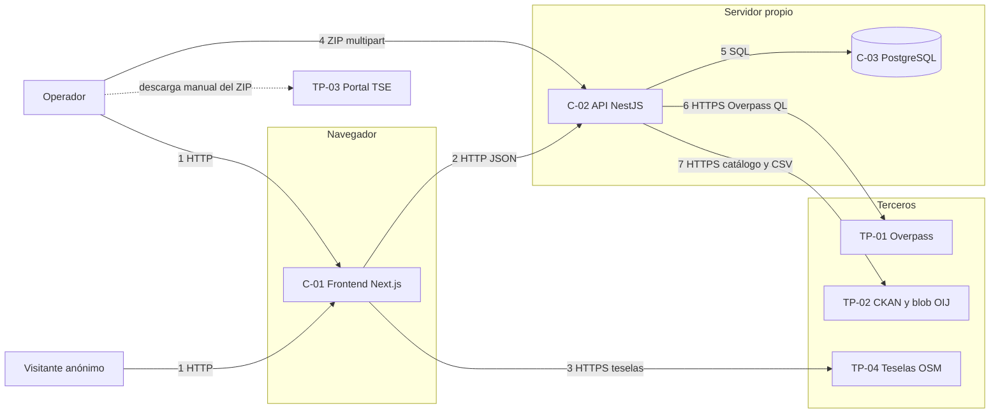

# Arquitectura y acceso (ítem 1.2)

Mapa mínimo de los componentes, datos protegidos y límites de confianza de los flujos [F-01, F-02 y F-03](flujos.md). La versión editable del diagrama es el modelo de OWASP Threat Dragon (ver [threat-model](../threat-model/README.md)); este archivo lo describe en texto para que el agente y las revisiones puedan consultarlo.

Estado: descripción del código al 2026-11-10 (commit `e5a1990`). No existe despliegue todavía.

## Componentes

| ID | Componente | Tecnología | Código |
|---|---|---|---|
| C-01 | Frontend web | Next.js 16, React 18, TanStack Query, Leaflet | `frontend/` |
| C-02 | API propia | NestJS 10, TypeORM | `backend/src/` |
| C-03 | Base de datos | PostgreSQL (`embedded-postgres` en local, puerto 5433) | `backend/scripts/local-db.mjs` |
| C-04 | Módulos de la API | `osm`, `tse`, `oij`, `coverage` | `backend/src/<módulo>/` |
| C-05 | Capa geográfica estática | `cantones-cr.geojson` servido por el frontend | `frontend/public/cantones-cr.geojson` |

## Servicios externos

| ID | Servicio | Qué se consume | Quién lo llama |
|---|---|---|---|
| TP-01 | Overpass API | Consulta Overpass QL, respuesta JSON | Backend (C-02) |
| TP-02 | Catálogo CKAN y blob de Azure del Poder Judicial | Metadatos y CSV de estadísticas policiales | Backend (C-02) |
| TP-03 | Portal de descarga del TSE | ZIP del padrón, descargado a mano por una persona | Operador, que luego lo sube al backend |
| TP-04 | `tile.openstreetmap.org` | Teselas del mapa | Navegador del visitante |

Detalle de cada uno en [terceros-secretos.md](terceros-secretos.md).

## Diagrama

### Límites de confianza

Cruces señalados en el diagrama:

1. Internet → navegador. No hay autenticación.
2. Navegador → API. CORS abierto a cualquier origen (`app.enableCors()` en `backend/src/main.ts`). No hay credenciales ni límite de peticiones.
3. Navegador → teselas de OSM. El tercero recibe la IP del visitante y la zona que mira.
4. Operador → API (ZIP con datos personales). Es el cruce con el dato más sensible.
5. API → base de datos. Con `DATABASE_URL`. TypeORM con `synchronize: true`.
6. API → Overpass. Respuesta de un tercero que se almacena tras normalizarla.
7. API → OIJ. Respuesta de un tercero; se valida el host del recurso y se prohíben redirecciones.

## Datos protegidos

| ID | Dato | Dónde está | Clasificación | Si se expone | Si se modifica | Si se pierde |
|---|---|---|---|---|---|---|
| D-01 | Padrón TSE (cédula, nombre, vencimiento, junta, código electoral) | ZIP subido; memoria del backend durante la importación; no se guarda | **Sensible**, datos personales | Violación de privacidad y de la normativa de protección de datos; daño al proyecto | No aplica, no se almacena | No aplica |
| D-02 | Agregados electorales (`TseElectoralSummary`) | BD | Público, agregado | Sin impacto relevante | Alto: falsifica el índice de viabilidad y los conteos mostrados | Medio: se reimporta desde el ZIP oficial |
| D-03 | Agregados OIJ (`OijDataset`) | BD | Público, agregado | Sin impacto relevante | Alto: estadísticas falsas | Bajo: se vuelve a sincronizar |
| D-04 | Lugares OSM (`OsmPlace`, `OsmQueryCache`) | BD | Público; `phone` y `website` pueden ser de personas físicas | Bajo | Medio: mapa y cobertura erróneos | Bajo: se vuelve a sincronizar |
| D-05 | `DATABASE_URL` | `backend/.env` | **Secreto** | Acceso total a la BD | No aplica | Sin servicio hasta rotarla |
| D-06 | Credenciales futuras (clave de administración, tokens de CI/CD, clave del proveedor de IA) | Por definir | **Secreto** | Control del sistema o de la cadena de entrega | No aplica | Bloqueo de despliegues |

## Inventario de endpoints

Todos son públicos hoy (**[O]**). La columna "Propuesto" refleja la regla pendiente de [Q-01](preguntas-abiertas.md#q-01) y [Q-02](preguntas-abiertas.md#q-02).

| Endpoint | Operación | Escribe | Hoy | Propuesto |
|---|---|---|---|---|
| `POST /osm/sync` | Consulta Overpass y reemplaza lugares | Sí | Público | Operador |
| `GET /osm/places` | Lista lugares por territorio y categoría | No | Público | Público |
| `GET /osm/by-category` | Lugares de una categoría | No | Público | Público |
| `GET /osm/locations` | Provincias y cantones permitidos | No | Público | Público |
| `POST /tse/import` | Importa el ZIP del padrón | Sí | Público | Operador |
| `GET /tse/overview` | Totales por provincia | No | Público | Público |
| `GET /tse/districts` | Agregados por distrito | No | Público | Público |
| `POST /oij/sync` | Descarga y agrega el CSV de un año | Sí | Público | Operador |
| `GET /oij/overview` | Indicadores y opciones de filtros | No | Público | Público |
| `GET /coverage/health` | Cobertura de salud por cantón | No | Público | Público |
| `GET /coverage/electoral-security` | Seguridad electoral por distrito | No | Público | Público |
| `GET /coverage/crime-rate` | Delitos por 1 000 electores | No | Público | Público |
| `GET /coverage/viability-index` | Índice compuesto 0–100 por cantón | No | Público | Público |
| `GET /coverage/business-types` | Tipos de negocio del OIJ | No | Público | Público |

## Matriz de acceso

Formato: actor o rol → recurso → acción → condición de acceso. "Hoy" es lo observado; "Propuesto" requiere la decisión de [Q-01](preguntas-abiertas.md#q-01) y [Q-02](preguntas-abiertas.md#q-02).

| Actor | Recurso | Acción | Condición hoy [O] | Condición propuesta [P] |
|---|---|---|---|---|
| Visitante anónimo | Páginas del frontend (`/`, `/mapa`, `/electoral`, `/oij`, `/cobertura`) | Ver | Sin condición | Sin condición |
| Visitante anónimo | Agregados D-02, D-03, D-04 (lecturas `GET`) | Leer | Sin condición | Sin condición |
| Visitante anónimo | Importación TSE (D-01 → D-02) | Escribir | **Sin condición** | Denegado (401/403) |
| Visitante anónimo | Sincronización OIJ (D-03) | Escribir | **Sin condición** | Denegado (401/403) |
| Visitante anónimo | Sincronización OSM (D-04) | Escribir | **Sin condición** | Denegado (401/403) |
| Operador | Importación TSE | Escribir | No existe el rol | Credencial de administración válida |
| Operador | Sincronización OIJ y OSM | Escribir | No existe el rol | Credencial de administración válida |
| Operador | Base de datos (D-02 a D-04) | Leer y escribir directo | Con `DATABASE_URL` | Solo desde la red del servidor, sin exposición pública |
| API (C-02) | Overpass, OIJ | Consultar | Sin credenciales; `User-Agent` informativo | Igual |
| Visitante o API | Datos personales del padrón (D-01) | Persistir o devolver | Se descartan; no se persisten ni se devuelven | Igual (regla [A], criterio [F01-AC2](flujos.md#f-01-importar-el-padrón-del-tse)) |

**Propiedad del recurso:** no aplica. No hay cuentas de usuario ni recursos con dueño; todo dato es del conjunto compartido.

**Acceso sin sesión:** hoy es el único modo de acceso. Esa es la brecha principal ([T-01](amenazas.md#t-01)).

## Dónde deben comprobarse los permisos

Los permisos deben aplicarse en el backend (guard o middleware de NestJS en `POST /osm/sync`, `POST /tse/import` y `POST /oij/sync`). Ocultar los botones en el frontend no es una protección: `frontend/lib/api.ts` llama directamente a esos endpoints y cualquiera puede hacer la misma petición sin la interfaz.
